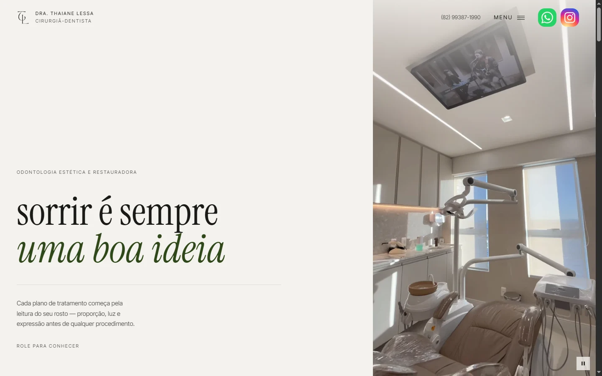
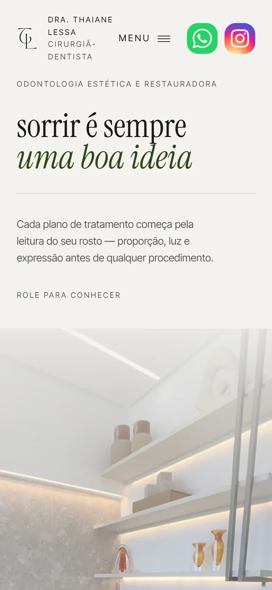
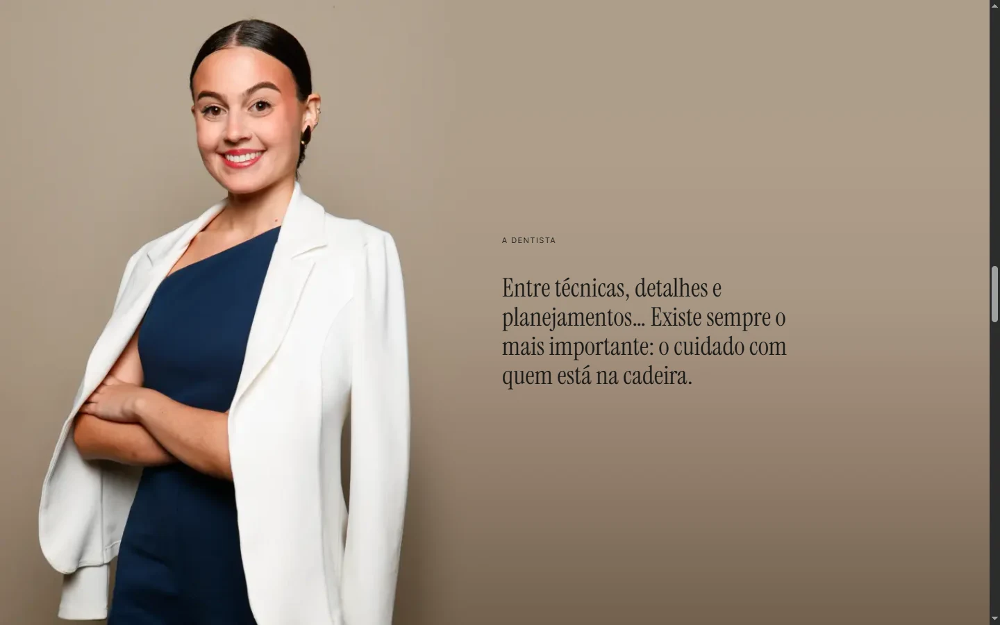
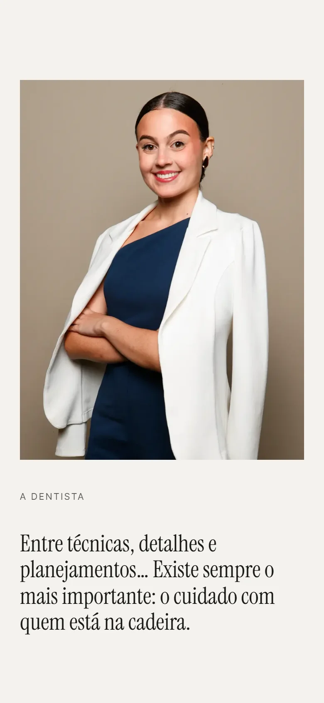

# landing-drathaiane

Landing page de uma cirurgiã-dentista em Maceió: uma página editorial, com movimento dirigido por scroll, que apresenta a profissional e leva o visitante ao WhatsApp.

Em construção. Prévia (fora dos buscadores): https://www.drathaianelessa.com.br

## O que já está no ar

Abertura com o monograma, cabeçalho com WhatsApp e Instagram, hero com vídeo, a seção Sobre e o rodapé com a identificação profissional. Serviços e Contato entram quando o conteúdo estiver pronto.

| Computador | Celular |
|---|---|
|  |  |
|  |  |

No computador, o retrato cresce com o scroll e o fundo da foto se abre até a largura da tela, para dar lugar ao texto.

## Stack

- [Next.js 16](https://nextjs.org) (App Router) e React 19, publicado na Vercel
- Tailwind CSS 4, tokens em `src/app/globals.css`
- [Motion](https://motion.dev) e [Lenis](https://lenis.darkroom.engineering) para o movimento; as peças presas ao scroll usam `requestAnimationFrame` próprio
- Vídeo próprio em VP9 e H.264, com poster

Por que cada uma: [`docs/adr/`](docs/adr/).

## Rodar

Requer Node 20 ou mais.

```bash
npm ci
npm run dev                            # http://localhost:3000
npm run lint
npx next typegen && npx tsc --noEmit   # typecheck
npm run build
```

## Documentação

| O quê | Onde |
|---|---|
| Produto, público, escopo, regras de publicidade odontológica | [`docs/PRD.md`](docs/PRD.md) |
| Design system: paleta, tipografia, movimento, tom de voz | [`docs/design/DESIGN.md`](docs/design/DESIGN.md) |
| Especificação de cada seção | [`docs/fdd/`](docs/fdd/) |
| Decisões técnicas | [`docs/adr/`](docs/adr/) |
| O que vem agora | [`docs/ROADMAP.md`](docs/ROADMAP.md) |
| Contexto para agentes de IA | [`CLAUDE.md`](CLAUDE.md) |

## Licença

Todos os direitos reservados. O código está aberto para leitura, como portfólio, sem licença de uso, cópia ou redistribuição.

Fotos, vídeos, logos, marca e textos da página são da Dra. Thaiane Lessa e aparecem aqui com a autorização dela. Não podem ser reutilizados.
